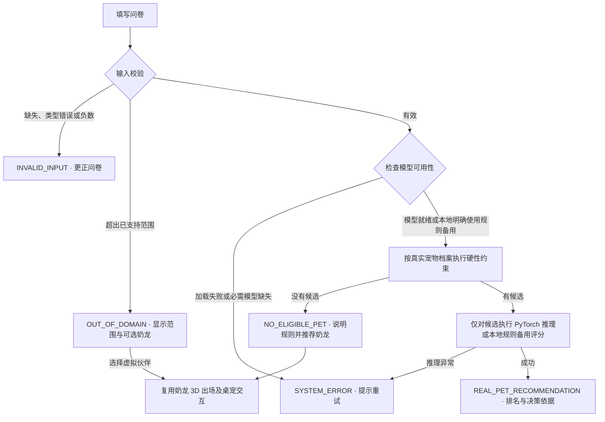

# Pico 宠物生活手册

Pico 是面向养宠准备者的宠物推荐与虚拟陪伴平台。通过中文照护档案、生活方式问卷和可解释推荐，帮助访客了解真实宠物和虚拟伙伴。

## 在线演示与完整应用

GitHub Pages 保留公开入口、宠物档案、对比清单和 3D 桌宠。配置托管服务后，从入口点击「选宠问卷」会进入同源 Flask 应用。Flask 版直接执行随附 PyTorch 模型和专家规则，并支持反馈、社区写入与 PDF 附件。模型实验室的公开页面可查看训练图表，本地版可上传数据并训练。

部署、健康检查、持久盘及连接入口的步骤见 [部署说明](DEPLOYMENT.md)。

向仓库的 `main` 分支提交并推送更改后，GitHub Actions 会构建并发布 Pages。可在 GitHub 的 **Actions** 中查看 `pages.yml` 工作流。本地构建采用 `python build_pages.py`，输出到 `_site/`。

首页共 9 位伙伴：猫、狗、兔子、仓鼠、刺猬、豹纹守宫、虎皮鹦鹉、观赏鱼、奶龙。「认识伙伴」提供照护条件快捷筛选和首年开销试算。问卷加入独处时长、外宿晚数、饲养环境管理和活饵准备四题。
奶龙是虚构的幻想伙伴。每次在「我的清单」点击 **Generate Pet** 都会播放全息开场。真实照护成本和推荐结果对应真实宠物。

随附的 `data/synthetic_v2` 是 6,000 位模拟用户、54,000 条配对的历史数据，包含当时的奶龙零标签占位。现有模型权重继续使用，线上推理、后续训练和新合成数据只处理 8 种真实宠物。新合成数据默认生成到 `data/synthetic_v3`。

已包含重新训练后的模型，可直接启动。新用户先按下方安装依赖；已有依赖的用户只需 python app.py，然后访问 http://127.0.0.1:8050 。

## Pico 推荐系统

V2 增强版：Flask + PyTorch 多层感知机 + 专家规则 + SQLite + 原生网页。

### Pico 设计参数

全站变量集中在 [static/style.css](static/style.css)。导航、问卷、社区、模型图表和桌宠面板共享同一套颜色与组件规范。

| 用途 | 变量 | 颜色 |
| --- | --- | --- |
| 品牌蓝 | `--brand-primary` | `#5E84C3` |
| 主要操作 | `--action` | `#426EAE` |
| 操作悬停、链接及焦点 | `--action-hover` | `#355D99` |
| 深蓝及主要文字 | `--ink` | `#304766` |
| 浅蓝背景 | `--light-blue` | `#EEF4FB` |
| 选中背景及装饰 | `--soft-blue` | `#E3EDFA` |
| 浅橙点缀 | `--peach` | `#FFC995` |
| 提示和虚拟陪伴背景 | `--soft-peach` | `#FCF1E7` |
| 页面背景 | `--page` | `#F5F8FC` |
| 卡片背景 | `--card` | `#FFFFFF` |
| 次要文字 | `--muted` | `#65758B` |
| 彩色背景上的次要文字 | `--muted-strong` | `#526783` |
| 分割线 | `--line` | `#D9E3F0` |
| 输入框边界 | `--control-border` | `#778DA9` |
| 成功、警告、错误 | `--success` / `--warning` / `--danger` | `#246748` / `#754F2A` / `#A23549` |

按钮、卡片、主要图片和输入框圆角分别为 12、16、20 和 10 px。基础间距以 4 px 为单位，按钮交互时长为 180 ms，并遵循系统减少动态效果设置。中文界面使用本地 Noto Sans SC 字形子集及系统中文字体回退。Poppins 用于英文标题和关键数值，Nunito Sans 用于英文正文和导航。字体与许可证均在 [static/brand/fonts](static/brand/fonts)，Logo 和 Favicon 来自原始 Pico 图形和字标。

### 在模型实验室上传并训练

1. 下载评分 CSV 样表，并替换示例数据。需要至少 20 位匿名用户，评分范围为 0–1。同一用户可评价不同宠物，问卷资料须一致。
2. 上传 UTF-8 CSV，点击「预览数据」核对样本、数据来源和按用户划分的结果。可用平铺问卷字段，或使用包含问卷 JSON 的 `profile` 列。宠物 ID 可从样表查询。旧版文件里的豚鼠和龙猫 ID 需要先删去相应行，或用适用于新档案的评分替换这些记录。
3. 点击「开始训练」。训练成功后立即启用新模型，模型版本、数据指纹、训练时间及图表随之更新。重新提交问卷即可使用新模型。网页上传的 CSV、日志和权重保存在本机 `data/training/`，重启会恢复最近启用的模型。

## 1. 先明确它能做什么
- 输入生活方式，检查 8 种真实宠物档案，给出适配排序、排除理由和照护提醒。所有档案都被排除时，可领养奶龙虚拟伙伴。
- 深度模型确实执行训练、反向传播、权重保存与推理，不是用规则冒充模型。
- 默认训练数据是程序模拟的，标签由规则生成。因此这是一套**规则蒸馏演示**，不能证明模型优于规则，也不能当成真实专家知识。
- 不根据图片推荐，不使用大语言模型接口，不需要付费 API。
- 本地缺少模型文件时可查看明确标注的专家规则备用评分。模型加载错误、计算异常或线上缺失模型会显示错误并提示重试。
- 所有宠物档案中的时间、预算、空间、寿命承诺和等级均为教学假设。不能直接用作动物福利、医疗或真实领养判断标准。

## 2. MacBook 本地启动（CPU 即可）
建议 Python 3.11。打开终端，将终端切换到本 README 所在文件夹：

```bash
cd /你的实际路径/PawthFinder
python3 -m venv .venv
source .venv/bin/activate
python -m pip install -r requirements.txt
python app.py
```
浏览器访问 http://127.0.0.1:8050 。如果包含 `artifacts/model.pt`，启动会自动加载；否则先显示规则模式。

训练或重新训练：
```bash
python train.py --users 1800 --epochs 80
```
用命令行更新随附模型后，重启网页进程以读取磁盘上的权重。网页实验室训练在当前进程内启用，并在重启后继续使用已启用的模型。

端口冲突：
```bash
PORT=8051 python app.py
```
此时访问 http://127.0.0.1:8051 。关闭服务按 Ctrl+C。
Windows 激活环境：`.venv\Scripts\activate`；启动命令相同。

离线环境需预先安装依赖；网页不使用 CDN。AutoDL 上无需为此小模型租 GPU。如需远程访问，请使用 SSH 端口转发到本机 8050，不要直接暴露开发服务器。

## 3. 目录
```text
app.py                 Flask 路由、SQLite、会话隔离、参数校验
core.py                输入规范、特征编码、硬规则、规则基线
network.py             PyTorch MLP 网络
engine.py              模型加载、推荐排序、规则解释
decision.py            推荐状态、规则汇总、虚拟伙伴兜底
train.py               模拟/真实数据训练、按用户划分、评估
export_feedback.py     人工触发反馈导出
requirements.txt       依赖版本范围
requirements-tested.txt  本次实际测试环境的锁定版本（若提供）
data/pets.json         可编辑的 9 位演示伙伴知识库
artifacts/model.pt     演示模型权重
artifacts/metrics.json  测试集结果与训练曲线数值
templates/index.html   中文问卷页面
static/                样式与交互脚本
tests/                 规则、梯度、模型兼容、API、会话测试
DESIGN.md              完整设计与数据接入说明
```

## 4. 输入与输出
问卷覆盖空间、每日时间、月预算、活动和噪声偏好、护理与经验、照护期限、过敏、居所许可、替代照护、离家作息及环境准备。预算以港币/月计算。0 元预算是有效输入，按宠物档案筛选。负数、缺漏或格式错误会提示更正。超出演示模型的数值范围会列出对应范围。

### 混合推荐与奶龙兜底流程



PyTorch 的输入仍为 24 维，使用随附权重和原有特征变换。过敏详情仅用于专家系统，现有布尔特征 `allergy` 对应 `has_allergy`。硬性规则先筛选，模型对留下的真实宠物评分，页面同时显示规则基线。0–100 分表示演示条件下的相对适配度。现有指标未验证最低推荐分，因此当前版本不触发 `LOW_COMPATIBILITY`。

### 过敏输入与规则

勾选过敏可多选宠物，并补充其他过敏原或标记具体过敏原不确定。取消勾选会同时清理四个过敏字段。API 按稳定的宠物 `id` 匹配。新字段 `has_allergy`、`allergy_types`、`allergy_uncertain` 和 `other_allergy` 存在同一份问卷 JSON 中，历史记录及只有布尔 `allergy` 的旧请求仍可读取和提交。

| 规则 | 执行条件 |
| --- | --- |
| H01、H02 | 居所未许可，或无外出与紧急替代照护 |
| H03、H04 | 档案要求环境管理或活饵准备，问卷尚未满足 |
| H05–H09 | 空间、时间、预算、承诺期限、可接受噪声，分别低于对应档案要求 |
| A01 | 用户明确选择的过敏对象匹配宠物档案，强制排除 |
| A02 | 具体过敏原不确定或未明确选择时，沿用原有演示规则对有毛档案做保守排除 |
| A03、A04 | 记录不确定情况与其他未映射过敏原，提示进一步确认 |

页面展示本次触发的规则编号、用户值与档案要求，以及候选数量、模型状态和实际排序。过敏风险因人而异，个体风险应向专业人员确认。[AAAAI 宠物过敏说明](https://www.aaaai.org/conditions-treatments/allergies/pet-allergy)

### 后端决策与结果页

- `REAL_PET_RECOMMENDATION` 展示真实候选和排序。真实候选可提交评分。
- `NO_ELIGIBLE_PET` 展示硬规则、条件差异和改善建议，播放奶龙的全息出场。点击「领养我的虚拟伙伴」直接打开现有桌宠。
- `OUT_OF_DOMAIN`（HTTP 422）展示适用范围，奶龙作为可选桌宠出现。
- `INVALID_INPUT` 和 `SYSTEM_ERROR` 提示更正或重试。损坏的权重、线上模型缺失及推理异常返回 `SYSTEM_ERROR`。

`/api/recommend` 附带 `recommendation_status`、`recommended_pets`、`excluded_pets`、`exclusion_reasons`、`triggered_rules`、`fallback_triggered`、`fallback_reason`、`virtual_companion` 和 `model_inference_status`。原有 `recommendations` 和 `excluded` 字段仍可使用。虚拟伙伴单独返回，真实排名中只有真实宠物档案。

没有合格候选时返回“暂无满足条件的宠物”，不强行推荐。

## 5. 测试
```bash
python -m pytest -q
```

在项目根目录用 Node 22+ 和 Chrome 运行 `node tests/browser_recommendation.mjs`，覆盖过敏字段清除、提交结果、超范围、奶龙预览与领养，以及断网后的页面恢复。可用 `PAWTH_TEST_PYTHON` 和 `PAWTH_TEST_CHROME` 指定可执行文件，也可用 `PAWTH_TEST_URL` 指定实际运行的问卷地址。
`artifacts/metrics.json` 中 MSE 越低越好；NDCG@3 越高越好。排序指标仅纳入至少两种合格候选且理想增益大于零的用户，同时报告有效用户数量。
模拟标签直接来自规则，因此规则基线 MSE 为零是预期行为，不是模型缺陷或真实性能证明。

## 6. 使用真实数据
CSV 列为 `user_id,profile,pet_id,score`；profile 是符合问卷字段规范的 JSON，score 为 0–1 的明确适配评分。详见 DESIGN.md。
```bash
python train.py --csv data/ratings.csv --data-source real --epochs 100
```
数据按 user_id 以约 70%/15%/15% 划分，避免同一用户出现在多个集合。至少 20 位用户只是保证程序可以划分，并非研究样本量建议。正式实验需要足量且代表性的数据。

网页反馈为 1–5 分，保存到本机 SQLite。显式导出：
```bash
python export_feedback.py
```
导出会映射到 0–1。反馈不是自动可信标签：只包含被推荐宠物，存在曝光偏差；未评价不能当作负样本。需要人工清洗、专家审核和真实匿名用户标识；会话标识不等于可靠用户身份。

## 7. 边界与数据管理
这是使用匿名浏览器会话的课程项目。问卷、反馈、社区记录和 PDF 附件由应用保存，本地默认目录为 `data/`。免费线上演示在临时目录保留当次运行的数据，服务重启会清空临时记录。推荐与反馈按签名会话隔离，社区帖子面向该应用的访客。
本地首次启动在数据目录生成 `.session_secret`。托管部署由平台生成 `PAWTH_SECRET`，重启时继续使用同一个值。运行数据库、密钥和用户上传的数据由服务保存。

实际发布前需核实知识库、获取数据授权、增加认证/限流/日志脱敏/HTTPS，并用真实用户与专业人士评估。本项目没有将合成评估伪装成真实业务效果。

## 8. V2 新增功能与操作

1. **宠物百科**：搜索名称、设置预算上限、按预算或时间排序；查看照护档案。
2. **对比清单**：在百科或推荐卡片点击“加入对比”，最多 3 类；横向比较月/年预算、时间、空间、承诺期限、活动、护理等属性。清单只将宠物 ID 保存到浏览器本地，刷新后保留。
3. **条件模拟**：先生成推荐，再点击“比较条件变化”，修改预算、时间、空间；对比前后合格状态和评分。模拟不创建历史记录；点击“将模拟条件填回问卷”后需重新提交，才会生成正式推荐。
4. **社区分享**：浏览、搜索、点赞、收藏和评论帖子，发布动态或带链接和 PDF 附件的论文分享。
5. **推荐报告下载**：生成 Markdown 文件，包含问卷、推荐、排除原因和限制说明。
6. **模型实验室**：预览上传的数据，手动启动训练，查看当前模型的训练记录、损失曲线、配对分布、预测与标签对照及规则基线。
7. **演示问卷**：标准示例、时间有限、户外爱好者三种预设，便于课堂展示。预设不是用户真实资料。

更新源码后重新运行 app.py 并刷新网页。源码包含与新版特征匹配的随附模型。

## 9. V3 合成后端数据集与自训练模型

已附上 data/synthetic_v2/：6000 位模拟用户、54000 条用户—宠物配对、CSV 固定划分、SQLite 数据库、数据字典及完整生成脚本。

推荐使用该版本的数据集训练命令：
```bash
python train.py --csv data/synthetic_v2/ratings.csv --data-source synthetic --epochs 100
```

默认 CSV 来源按合成数据处理，只有真实采集数据才应显式传 --data-source real。带有 synthetic 来源标记的 CSV 无法冒充真实数据。
已随包附上本次实际训练得到的 model.pt、metrics.json。网页加载该模型，模型实验室显示数据指纹与划分记录。
命令行训练后可重启 app.py 读取随附模型。网页实验室训练完成后直接切换模型。

详细字段、标签公式与 SQLite 查询方式见 data/synthetic_v2/DATASET_CARD.md。
