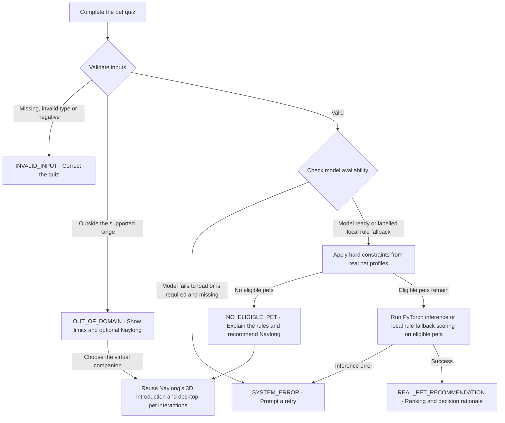

# Pico Pet Lifestyle Guide

**[Open the live Pico demo](https://idat7215-pawthfinder-demo.onrender.com/)**

Pico is a pet recommendation and virtual companionship platform for people preparing to care for a pet. Its care profiles, lifestyle quiz and explainable recommendations help visitors get to know real pets and virtual companions.

## Online Demo and Full Application

GitHub Pages provides the public entry point, pet profiles, a comparison list and 3D desktop pets. Once hosting is configured, **Pet Quiz** opens the full Flask application on its own HTTPS origin. Flask runs the bundled PyTorch model and expert rules and supports feedback, community posting and PDF attachments. The public Model Lab shows training charts. The local version also supports uploading data and training.

See the [deployment guide](DEPLOYMENT.md) for hosting, health checks, persistent storage and linking the entry point.

Pushing changes to `main` triggers GitHub Actions to build and publish the Pages site. See the `pages.yml` workflow under **Actions**. To build locally, run `python build_pages.py`. The output goes to `_site/`.

The homepage introduces nine companions: a cat, a dog, a rabbit, a hamster, a hedgehog, a leopard gecko, a budgerigar, an ornamental fish and Naylong. **Meet Companions** offers care filters and a first-year cost estimate. The quiz includes four questions about time spent alone, nights away, habitat management and preparation for live food.
Naylong is a fictional companion. Selecting **Generate Pet** in **My List** plays the holographic introduction each time. Care costs and recommendation scores apply to real pets.

The historical `data/synthetic_v2` dataset contains 6,000 simulated users and 54,000 pairs, including the old zero-label placeholder for Naylong. The existing weights still work. Online inference, further training and new synthetic data use only the eight real pets. New synthetic data defaults to `data/synthetic_v3`.

The retrained model is bundled and ready to run. New users can install the dependencies below. With dependencies already installed, run `python app.py` and visit http://127.0.0.1:8050.

## Pico Recommendation System

V2 combines Flask, a PyTorch multilayer perceptron, expert rules, SQLite and a vanilla web interface.

### Pico Design Tokens

The shared variables are defined in [static/style.css](static/style.css). Navigation, the quiz, the community, model charts and the desktop pet panel use the same colours and component styles.

| Use | Variable | Colour |
| --- | --- | --- |
| Brand blue | `--brand-primary` | `#5E84C3` |
| Primary actions | `--action` | `#426EAE` |
| Hover, links and focus | `--action-hover` | `#355D99` |
| Deep blue and primary text | `--ink` | `#304766` |
| Light blue background | `--light-blue` | `#EEF4FB` |
| Selection and decoration | `--soft-blue` | `#E3EDFA` |
| Peach accent | `--peach` | `#FFC995` |
| Notices and virtual companion background | `--soft-peach` | `#FCF1E7` |
| Page background | `--page` | `#F5F8FC` |
| Card background | `--card` | `#FFFFFF` |
| Secondary text | `--muted` | `#65758B` |
| Secondary text on tinted backgrounds | `--muted-strong` | `#526783` |
| Dividers | `--line` | `#D9E3F0` |
| Input borders | `--control-border` | `#778DA9` |
| Success, warning and error | `--success` / `--warning` / `--danger` | `#246748` / `#754F2A` / `#A23549` |

Buttons, cards, main images and inputs have corner radii of 12, 16, 20 and 10 px respectively. Base spacing uses 4 px increments. Button transitions run for 180 ms and respect the system's reduced-motion setting. Chinese text uses a local Noto Sans SC subset with system Chinese fonts as fallbacks. Poppins is used for English headings and key figures. Nunito Sans is used for English body text and navigation. Fonts and licences are in [static/brand/fonts](static/brand/fonts). The logo and favicon use the original Pico mark and wordmark.

### Upload and Train in Model Lab

1. Download the sample ratings CSV and replace the sample records. Supply at least 20 anonymous users and scores from 0 to 1. Each user can rate multiple pets with the same quiz profile.
2. Upload a UTF-8 CSV and select **Preview Data** to check the sample, data source and user-level split. The CSV can contain individual quiz fields or a `profile` column with quiz JSON. The sample lists the pet IDs. Remove rows with old guinea pig and chinchilla IDs, or replace them with ratings that apply to the current profiles.
3. Select **Start Training**. When training succeeds, the new model becomes active immediately and the version, data fingerprint, training time and charts update. Submit the quiz again to use the new model. The application stores uploaded CSVs, logs and weights in `data/training/` and restores the most recently activated model on restart.

## 1. What Pico Does
- Uses lifestyle information to evaluate eight real pet profiles and provide rankings, exclusion reasons and care reminders. Visitors can adopt Naylong as a virtual companion if the rules exclude every real pet.
- The neural network runs training, backpropagation, weight persistence and inference.
- Default training data is simulated, with labels generated by the rules. This **rule distillation demo** illustrates model behaviour on synthetic labels. It cannot establish that the model outperforms the rules or provide real expert knowledge.
- The project uses lifestyle inputs and runs without image-based recommendations, language model APIs or paid APIs.
- When the local model file is absent, Pico can show a clearly labelled expert-rule fallback score. A model load error, an inference failure or a missing hosted model displays an error and prompts a retry.
- The time, budget, space, lifespan commitments and ratings in the pet profiles are assumptions for teaching. Use them only for demonstrations, with animal welfare, medical and adoption decisions based on qualified guidance.

## 2. Run Locally on a MacBook (CPU)
Python 3.11 is recommended. In a terminal, change to the folder containing this README.

```bash
cd /path/to/PawthFinder
python3 -m venv .venv
source .venv/bin/activate
python -m pip install -r requirements.txt
python app.py
```
Open http://127.0.0.1:8050. If `artifacts/model.pt` is present, the application loads it at startup. Otherwise it starts in rules mode.

To train or retrain the model, run the following command.
```bash
python train.py --users 1800 --epochs 80
```
After updating the bundled model from the command line, restart the web process to load the saved weights. Training in Model Lab activates the model in the current process and retains it after a restart.

If the default port is in use, run the following command.
```bash
PORT=8051 python app.py
```
Open http://127.0.0.1:8051. Press Ctrl+C to stop the service.
On Windows, activate the environment with `.venv\Scripts\activate` and use the same start command.

Install the dependencies before running offline. The site uses local assets. The model is small enough to run on a CPU on AutoDL. For remote access, forward local port 8050 over SSH and keep the development server private.

## 3. Project Structure
```text
app.py                    Flask routes, SQLite, session isolation and input validation
core.py                   Input schema, feature encoding, hard rules and rule baseline
network.py                PyTorch multilayer perceptron
engine.py                 Model loading, ranking and rule explanations
decision.py               Recommendation states, rule summary and virtual companion fallback
train.py                  Training on synthetic or real data, user-level splits and evaluation
export_feedback.py        Manual feedback export
requirements.txt          Dependency version ranges
requirements-tested.txt   Pinned versions from testing, if supplied
data/pets.json            Editable knowledge base for nine demo companions
artifacts/model.pt        Trained weights for the demo
artifacts/metrics.json    Test-set results and training-curve data
data/pets.en.json         English pet profile copy
templates/index.html      British English interface and quiz
static/                   Styles and interaction scripts
tests/                    Rule, gradient, model compatibility, API and session tests
DESIGN.md                 Design and data integration guide
```

## 4. Inputs and Outputs
The quiz covers space, daily time, monthly budget, activity and noise preferences, grooming, experience, care commitment, allergies, housing permission, backup care, time away and habitat preparation. Budget is measured in Hong Kong dollars per month. A budget of HK$0 is valid and is checked against the pet profiles. Negative, missing or malformed values prompt correction. Values outside the demo model's supported range return the relevant limits.

### Hybrid Recommendations and the Naylong Fallback



PyTorch keeps the existing 24 input features, bundled weights and feature transformations. The expert system uses detailed allergy information. The model's existing Boolean `allergy` feature maps to `has_allergy`. Hard rules filter the candidates first, then the model ranks the remaining real pets. The page also shows the rule baseline. Scores of 0–100 express relative compatibility in demo conditions. `LOW_COMPATIBILITY` remains inactive pending validation of a minimum score.

### Allergy Inputs and Rules

Visitors can select multiple pets when they indicate an allergy, specify other allergens or mark the allergen as uncertain. Clearing the allergy option clears all four related fields. The API matches stable pet `id` values. `has_allergy`, `allergy_types`, `allergy_uncertain` and `other_allergy` are stored in the same quiz JSON. Historical records and older requests with only the Boolean `allergy` remain supported for reading and submission.

| Rule | Condition |
| --- | --- |
| H01, H02 | Housing permission is absent, or backup care is unavailable for travel or emergencies |
| H03, H04 | The profile requires habitat management or live food preparation, and the quiz answers fall short |
| H05–H09 | Space, time, budget, commitment or tolerated noise is below the corresponding profile requirement |
| A01 | An allergy object expressly selected by the visitor matches the profile, so the pet is excluded |
| A02 | If the allergen is uncertain or unspecified, the existing demo rules conservatively exclude pets with fur |
| A03, A04 | Record uncertainty or other unmapped allergens and prompt further confirmation |

The page shows triggered rule IDs, the user's answers, profile requirements, the eligible pet count, model status and the actual ranking. Allergy risk varies from person to person. Consult a qualified professional about individual risk. [AAAAI guidance on pet allergies](https://www.aaaai.org/conditions-treatments/allergies/pet-allergy)

### Backend Decisions and Results

- `REAL_PET_RECOMMENDATION` shows eligible real pets in ranked order. Visitors can rate the recommended pets.
- `NO_ELIGIBLE_PET` shows the hard rules, unmet care requirements and suggestions. Naylong plays its holographic introduction. **Adopt my virtual companion** opens the existing desktop pet.
- `OUT_OF_DOMAIN` (HTTP 422) shows the supported ranges and offers Naylong as an optional desktop pet.
- `INVALID_INPUT` and `SYSTEM_ERROR` prompt correction or retry. Corrupt weights, a missing hosted model and inference failures return `SYSTEM_ERROR`.

`/api/recommend` returns `recommendation_status`, `recommended_pets`, `excluded_pets`, `exclusion_reasons`, `triggered_rules`, `fallback_triggered`, `fallback_reason`, `virtual_companion` and `model_inference_status`. The original `recommendations` and `excluded` fields remain available. The virtual companion is returned separately. Only real pet profiles appear in the ranking.

If no pet qualifies, the application returns a message explaining that no pet meets the current conditions.

## 5. Tests
```bash
python -m pytest -q
```

From the project root, run `node tests/browser_recommendation.mjs` with Node 22+ and Chrome. It covers clearing allergy fields, submitting the quiz, out-of-range inputs, previewing and adopting Naylong, and recovery after a dropped connection. Use `PAWTH_TEST_PYTHON` and `PAWTH_TEST_CHROME` to select executables and `PAWTH_TEST_URL` to target a running quiz.
In `artifacts/metrics.json`, lower MSE and higher NDCG@3 are better. The ranking metric includes only users with at least two eligible pets and positive ideal gain. The report includes the number of eligible users.

The rules generate the synthetic labels, so a rule-baseline MSE of zero is expected. Its meaning is limited to the synthetic evaluation.

## 6. Use Real Data
The CSV columns are `user_id,profile,pet_id,score`. The `profile` field holds JSON that follows the quiz schema, and `score` is an explicit compatibility rating from 0 to 1. See DESIGN.md for details.
```bash
python train.py --csv data/ratings.csv --data-source real --epochs 100
```
Records are split by `user_id` at approximately 70%/15%/15%, so each user belongs to one split. A minimum of 20 users allows the program to split the data. A formal study needs a sufficient, representative sample.

Website feedback uses a 1–5 scale and is stored in local SQLite. To export it, run the following command.
```bash
python export_feedback.py
```
The export maps scores to 0–1. Feedback reflects exposure bias because visitors rate only recommended pets. Exclude unrated pairs from negative labels. Preparing training data requires manual cleaning, expert review and reliable anonymised user IDs. A browser session ID alone cannot establish identity.

## 7. Scope and Data Management
This course project uses anonymous browser sessions. The application stores quiz responses, feedback, community records and PDF attachments. The local default directory is `data/`. The free hosted demo uses temporary storage for the current run, and a restart clears temporary records. A signed session isolates recommendations and feedback. Community posts are visible to visitors of the application.
On first local startup, the application generates `.session_secret` in the data directory. The hosting platform generates `PAWTH_SECRET` and reuses the same value across restarts. The service keeps the runtime database, secrets and uploaded data.

For a production release, verify the knowledge base, obtain data permissions, add authentication, rate limiting, log redaction and HTTPS, and evaluate the system with real users and professionals. The reported synthetic evaluation applies to the teaching demo.

## 8. V2 Features and Use

1. **Pet catalogue**. Search by pet name, set a budget cap, sort by budget or care time, and read the care profiles.
2. **Comparison list**. Select **Add to My List** from the catalogue or a recommendation card. Compare up to three pets by monthly and annual budget, care time, space, commitment, activity and grooming needs. The browser stores pet IDs locally so the list persists across refreshes.
3. **Scenario comparison**. Generate a recommendation, then compare changes to budget, time and space. Review eligibility and scores before and after the changes. Scenarios are temporary. After selecting **Use these values in the quiz**, submit again to generate and save the updated recommendation.
4. **Community**. Browse, search, like, save and comment on posts. Publish updates or research posts with links and PDF attachments.
5. **Recommendation report**. Download a Markdown file with the quiz responses, recommendations, exclusion reasons and limitations.
6. **Model Lab**. Preview uploaded data, start training manually and view the current model's training history, loss curves, pair distributions, predictions versus labels and rule baseline.
7. **Demo profiles**. Use the Standard, Limited time and Outdoor enthusiast presets for classroom demonstrations. Each preset contains example data.

After updating the source, restart `app.py` and refresh the page. The source includes a bundled model compatible with the new features.

## 9. V3 Synthetic Dataset and Model Training

The bundled `data/synthetic_v2/` directory contains 6,000 simulated users, 54,000 user–pet pairs, fixed CSV splits, a SQLite database, a data dictionary and the full generation scripts.

To train using this dataset, run the following command.
```bash
python train.py --csv data/synthetic_v2/ratings.csv --data-source synthetic --epochs 100
```
The default CSV source is synthetic. Reserve `--data-source real` for collected data. Files marked as synthetic are rejected when imported as real data.
The trained `model.pt` and `metrics.json` are included. The website loads that model, and Model Lab shows the data fingerprint and split records.
After command-line training, restart `app.py` to load the bundled model. Training in Model Lab switches the model when training completes.

See `data/synthetic_v2/DATASET_CARD.md` for fields, label formulas and SQLite queries.
